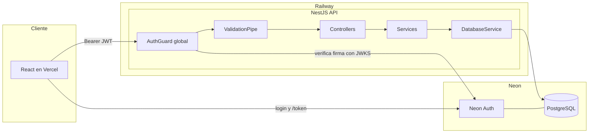
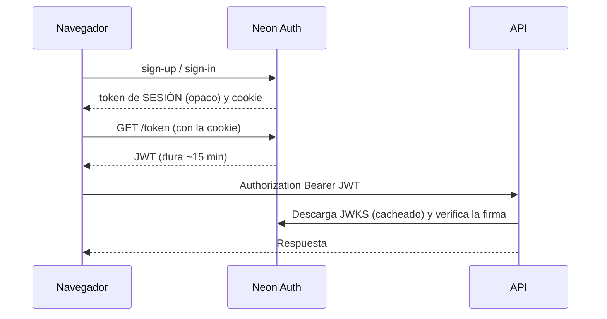
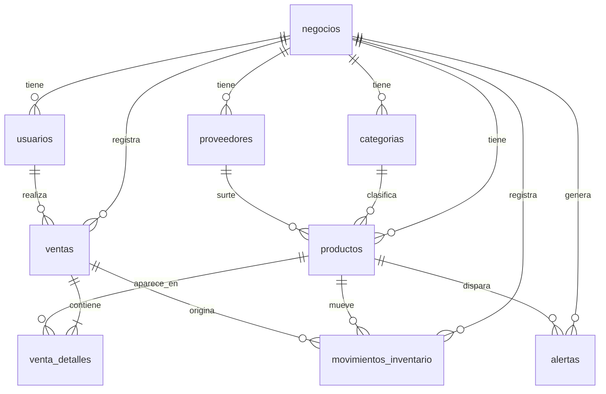
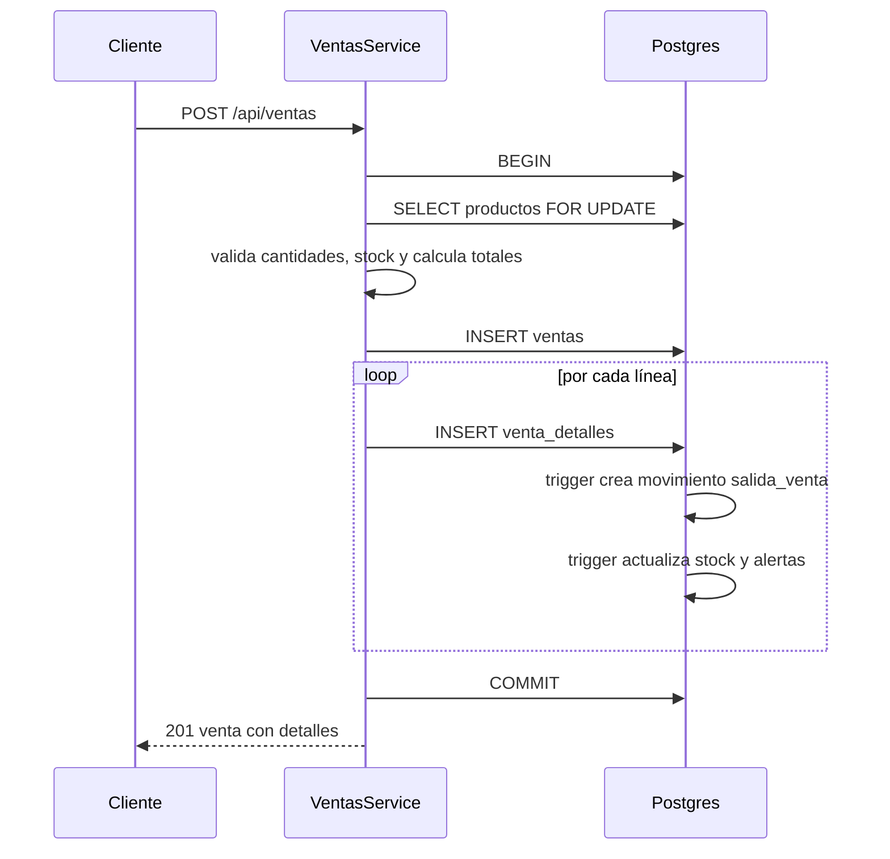

# StockFácil — Documentación del proyecto

> **Plataforma web de inventario y ventas para pequeñas tiendas**
> **App:** https://stock-facil-kappa.vercel.app · **API:** https://stockfacil-production.up.railway.app/api · **Versión de la API:** 0.3.0

Este documento describe el proyecto completo: qué hace, cómo está construido (base de datos, API y frontend), cómo se ejecuta y se despliega, qué decisiones se tomaron y qué falta por hacer.

---

## Índice

1. [Visión general](#1-visión-general)
2. [Stack tecnológico](#2-stack-tecnológico)
3. [Estructura del repositorio](#3-estructura-del-repositorio)
4. [Arquitectura](#4-arquitectura)
5. [Autenticación y multi-tenencia](#5-autenticación-y-multi-tenencia)
6. [Base de datos](#6-base-de-datos)
7. [Reglas de negocio y flujos](#7-reglas-de-negocio-y-flujos)
8. [Referencia de la API](#8-referencia-de-la-api)
9. [Manejo de errores](#9-manejo-de-errores)
10. [Frontend](#10-frontend)
11. [Metodología y convenciones](#11-metodología-y-convenciones)
12. [Configuración y ejecución local](#12-configuración-y-ejecución-local)
13. [Despliegue en producción](#13-despliegue-en-producción)
14. [Datos de demostración](#14-datos-de-demostración)
15. [Pruebas y documentación de la API](#15-pruebas-y-documentación-de-la-api)
16. [Decisiones de diseño](#16-decisiones-de-diseño)
17. [Limitaciones conocidas y pendientes](#17-limitaciones-conocidas-y-pendientes)
18. [Cómo extender el sistema](#18-cómo-extender-el-sistema)
19. [Glosario](#19-glosario)

---

## 1. Visión general

**Qué resuelve:** una pequeña tienda se registra, crea su negocio, da de alta su catálogo con precios y existencias, registra entradas y salidas de mercancía y vende desde un punto de venta. El sistema:

- actualiza el inventario automáticamente tras cada movimiento o venta,
- genera una **alerta** cuando un producto llega a su stock mínimo,
- muestra un **dashboard** con ventas, utilidad, ventas por día, productos más vendidos y valor del inventario.

**Principios del diseño:**

| Principio | Cómo se aplica |
|---|---|
| **Multi-tenant** | Cada tienda es un `negocio`. Todas las tablas de negocio llevan `negocio_id` y **toda consulta lo filtra**. Una tienda nunca ve datos de otra. |
| **El stock se mueve solo con movimientos** | `productos.stock_actual` nunca se edita directamente; lo actualizan triggers a partir del kardex. |
| **Historial inmutable** | Los productos se *desactivan* y las ventas se *anulan*; nada con historial se borra. |
| **Integridad en la base de datos** | Restricciones, triggers y transacciones protegen los datos aunque la capa de aplicación falle. |
| **Identidad delegada** | Contraseñas, sesiones y correos viven en Neon Auth; la API solo verifica el JWT. |
| **Unidades enteras o decimales por producto** | Cada producto declara si admite decimales (peso/volumen); la regla se aplica en la interfaz, la API y la base de datos. |

---

## 2. Stack tecnológico

| Capa | Tecnología | Para qué |
|---|---|---|
| Frontend | **React 19**, **TypeScript 6**, **Vite 8** | Interfaz de usuario |
| Estilos | **Tailwind CSS 4** + tokens del tema de `@neondatabase/auth-ui` | Diseño y componentes de autenticación coherentes |
| Enrutado | **React Router 8** | Navegación en el cliente |
| Backend | **NestJS** (módulos **ESM**), **TypeScript** | API REST modular |
| Base de datos | **PostgreSQL en Neon** | Datos, triggers, vistas |
| Driver | **`pg`** (node-postgres) | Pool y consultas SQL parametrizadas |
| Autenticación | **Neon Auth** (Better Auth administrado) | Registro, login y emisión de JWT |
| Verificación JWT | **`jose`** | Valida la firma contra el JWKS de Neon Auth |
| Validación | **`class-validator`** + **`class-transformer`** | DTOs y validación de entrada |
| Configuración | **`@nestjs/config`** | Variables de entorno |
| Documentación API | **OpenAPI 3.0.3** (importable en Apidog) | Referencia de endpoints |
| Hosting | **Vercel** (frontend), **Railway** (API), **Neon** (base de datos) | Producción |

> Las versiones exactas están en `backend/package.json` y `frontend/package.json`.

---

## 3. Estructura del repositorio

```
StockFacil/
├─ .env                     ← variables de entorno locales (NO se sube a git)
├─ .gitignore
├─ package.json             ← workspaces: ["backend", "frontend"]
├─ README.md
├─ openapi-api.json         ← especificación de la API
├─ db/
│  └─ schema.sql            ← tablas, tipos, triggers y vistas
├─ backend/                 ← API NestJS
└─ frontend/                ← aplicación React
   └─ vercel.json           ← reglas de rutas para la SPA
```

### Backend (`backend/src/`)

```
├─ main.ts                  ← arranque: prefijo /api, pipes, filtros, CORS
├─ app.module.ts            ← módulo raíz
├─ debug.controller.ts      ← /health (público) y /whoami (depuración)
├─ common/
│  ├─ dto.ts                ← toBool, DateRangeDto, resolveRange, round2
│  ├─ cantidad.ts           ← assertCantidad (enteros vs decimales)
│  └─ pg-exception.filter.ts← traduce errores de Postgres a HTTP
├─ database/                ← módulo GLOBAL: pool pg, query, queryOne, tx
├─ auth/                    ← guard global JWT + decoradores @Public, @AllowNoProfile, @Auth, @Tenant
├─ negocio/                 ← /me y /onboarding
├─ catalogo/                ← categorías y proveedores
├─ productos/               ← catálogo de productos
├─ inventario/              ← movimientos (kardex)
├─ ventas/                  ← ventas, detalle y anulación
├─ alertas/                 ← bandeja de alertas de stock bajo
└─ reportes/                ← reportes de ventas e inventario
```

Cada módulo de negocio sigue el patrón `*.dto.ts` → `*.controller.ts` → `*.service.ts` → `*.module.ts`.

### Frontend (`frontend/src/`)

```
├─ main.tsx, App.tsx        ← arranque y rutas
├─ neon.ts                  ← cliente de Neon Auth
├─ api.ts                   ← cliente HTTP, tipos y todos los endpoints
├─ ui.ts                    ← clases de Tailwind reutilizables (input, btn, card…)
├─ me-context.ts            ← contexto con el perfil, el negocio y el formateo de dinero
├─ movimientos.ts           ← etiquetas de tipos de movimiento y formato de fechas
├─ ventas.ts                ← métodos de pago
├─ num.ts                   ← redondeo y validación de cantidades
├─ fechas.ts                ← días y rangos en la zona horaria del negocio
├─ components/
│  ├─ Shell.tsx             ← sesión, onboarding, cabecera y navegación
│  └─ ProductoForm.tsx      ← alta y edición de productos (modal)
└─ pages/
   ├─ Auth.tsx, Account.tsx ← inicio de sesión / registro y cuenta (Neon Auth UI)
   ├─ Onboarding.tsx        ← alta del negocio
   ├─ Inicio.tsx            ← dashboard
   ├─ Productos.tsx
   ├─ Inventario.tsx
   ├─ Vender.tsx            ← punto de venta
   └─ Ventas.tsx            ← historial
```

---

## 4. Arquitectura

### 4.1 Vista general



### 4.2 Ciclo de vida de una petición

1. **CORS**: solo se aceptan los orígenes de `FRONTEND_URL` (métodos `GET, POST, PATCH, DELETE`; cabeceras `Content-Type` y `Authorization`).
2. **`AuthGuard` (global)**: si la ruta es `@Public()`, pasa. Si no, exige `Authorization: Bearer <jwt>`, verifica firma, expiración e *issuer*, extrae el `sub` y carga el perfil de `usuarios` (`negocio_id`, `usuario_id`, `rol`). Sin perfil y sin `@AllowNoProfile()` → **403 `ONBOARDING_REQUIRED`**.
3. **`ValidationPipe` (global)**: valida y transforma `body`, `query` y `params` con los DTOs (`whitelist`, `forbidNonWhitelisted`, `transform`).
4. **Controller**: recibe los datos validados y el contexto (`@Tenant()`, `@Auth()`).
5. **Service**: reglas de negocio y SQL; toda consulta incluye `negocio_id`.
6. **`DatabaseService`**: pool de conexiones; `tx()` para transacciones.
7. **Postgres**: restricciones y triggers garantizan la integridad.
8. **`PgExceptionFilter` (global)**: convierte errores de Postgres en respuestas HTTP legibles.

### 4.3 Módulos del backend

| Módulo | Responsabilidad |
|---|---|
| `DatabaseModule` (global) | Pool y API `query`, `queryOne`, `tx` |
| `AuthModule` | Registra el `AuthGuard` global |
| `NegocioModule` | Perfil del usuario y alta del negocio |
| `CatalogoModule` | Categorías y proveedores |
| `ProductosModule` | CRUD de productos (baja lógica) |
| `InventarioModule` | Movimientos manuales y kardex |
| `VentasModule` | Registro, consulta y anulación de ventas |
| `AlertasModule` | Lectura y cierre de alertas |
| `ReportesModule` | Consultas agregadas |

---

## 5. Autenticación y multi-tenencia

### 5.1 Flujo para obtener un token



> ⚠️ El `token` que devuelven *sign-up* y *sign-in* es un **token de sesión opaco**, **no** un JWT. Para llamar a la API hay que pedir el JWT con `GET /token` (en el frontend, `authClient.token()`).

### 5.2 Verificación del JWT (`auth.guard.ts`)

- Las claves públicas se leen del **JWKS**: `NEON_AUTH_BASE_URL` + `NEON_AUTH_JWKS_URL` (o `/.well-known/jwks.json` por defecto). Si `NEON_AUTH_JWKS_URL` es una URL completa, se usa tal cual.
- Se acepta como *issuer* el **origin** de `NEON_AUTH_BASE_URL` y también la URL completa.
- El `sub` debe ser un **UUID** (el `id` de `neon_auth."user"`); si no, 401.

### 5.3 Decoradores

| Decorador | Efecto |
|---|---|
| `@Public()` | Ruta sin autenticación (`/health`) |
| `@AllowNoProfile()` | Exige token válido pero **no** negocio (`/me`, `/onboarding`) |
| `@Auth()` | Inyecta `{ authUserId, email, name }` del token |
| `@Tenant()` | Inyecta `{ usuarioId, negocioId, rol }` del perfil |

### 5.4 Multi-tenencia

```
JWT (sub) ──► usuarios.auth_user_id ──► negocio_id ──► filtro en TODAS las consultas
```

- Cada servicio recibe `TenantCtx` y usa `t.negocioId` en cada `WHERE`.
- Al referenciar entidades por id (categoría, proveedor, producto) se verifica que **pertenezcan al mismo negocio**. Un id de otra tienda responde 400 o 404, nunca filtra datos.
- El nombre y el correo del usuario **no se duplican**: viven en Neon Auth y se obtienen con `LEFT JOIN` a `neon_auth."user"`.

### 5.5 Roles

`usuarios.rol` admite `propietario` y `empleado`. **Hoy ningún endpoint distingue entre ambos** (ver [pendientes](#17-limitaciones-conocidas-y-pendientes)).

---

## 6. Base de datos

El esquema está en `db/schema.sql` y se aplica manualmente en el **SQL Editor de Neon**, con **Neon Auth ya habilitado** (hay una llave foránea a `neon_auth."user"`).

### 6.1 Modelo entidad-relación



### 6.2 Tablas

| Tabla | Propósito | Notas clave |
|---|---|---|
| `negocios` | La tienda (tenant) | `moneda` (default `MXN`), `zona_horaria` (default `America/Monterrey`) |
| `usuarios` | Perfil de la app | `auth_user_id` **UUID único** con llave foránea a `neon_auth."user"(id)`; `rol`; `activo` |
| `categorias` | Clasificación | `UNIQUE (negocio_id, nombre)` |
| `proveedores` | Proveedores | `activo` (baja lógica) |
| `productos` | Catálogo | `UNIQUE (negocio_id, sku)`; `stock_actual`, `stock_minimo`; **`permite_decimales`** (default `false`); `activo`; **`CHECK (stock_actual >= 0)`** |
| `ventas` | Encabezado de venta | `estado` (`completada` / `anulada`), `metodo_pago`, `subtotal`, `descuento`, `total` |
| `venta_detalles` | Líneas de venta | Guarda `precio_unitario` y `costo_unitario` **al momento de vender**; `subtotal` es columna generada |
| `movimientos_inventario` | **Kardex** | `cantidad` siempre positiva; el `tipo` define si suma o resta |
| `alertas` | Avisos de stock bajo | `leida` (false = pendiente); índice único parcial: **una sola pendiente por producto** |

**Tipos enumerados**

| Tipo | Valores |
|---|---|
| `rol_usuario` | `propietario`, `empleado` |
| `estado_venta` | `completada`, `anulada` |
| `metodo_pago` | `efectivo`, `tarjeta`, `transferencia`, `otro` |
| `tipo_movimiento` | `entrada_compra`, `entrada_ajuste`, `entrada_anulacion`, `salida_venta`, `salida_ajuste`, `salida_devolucion` |

**Tipos numéricos:** dinero `NUMERIC(12,2)`; cantidades `NUMERIC(12,3)`.

### 6.3 Triggers

| Trigger | Se dispara | Qué hace |
|---|---|---|
| `trg_cantidad_entera` → `fn_validar_cantidad_entera()` | `BEFORE INSERT` en `movimientos_inventario` | Rechaza (`check_violation`) cantidades con decimales si el producto tiene `permite_decimales = false` |
| `trg_salida_por_venta` → `fn_salida_por_venta()` | `AFTER INSERT` en `venta_detalles` | Inserta el movimiento `salida_venta` de esa línea |
| `trg_aplicar_movimiento` → `fn_aplicar_movimiento()` | `AFTER INSERT` en `movimientos_inventario` | Suma o resta `stock_actual`; si una **salida** deja el stock `<= stock_minimo`, crea la alerta; si una **entrada** lo deja `> stock_minimo`, cierra las pendientes |

Si el stock fuera a quedar negativo, el `CHECK` de `productos` aborta toda la transacción.

### 6.4 Vistas e índices

- El esquema define `v_ventas_diarias`, `v_desempeno_productos`, `v_stock_bajo` y `v_valor_inventario`. **La API no las usa** (los reportes consultan las tablas porque necesitan filtros por fecha y zona horaria); quedan para consultas manuales.
- Índices destacados: `productos (negocio_id, nombre)`, índice parcial de stock bajo, `ventas (negocio_id, fecha)`, `movimientos_inventario (negocio_id, fecha)` y `uq_alerta_pendiente` (único parcial `(producto_id) WHERE NOT leida`).

---

## 7. Reglas de negocio y flujos

### 7.1 Onboarding

1. El usuario se registra en Neon Auth (aún sin negocio).
2. `GET /me` devuelve `perfil: null` → el frontend muestra el alta del negocio.
3. `POST /onboarding` crea, **en una transacción**, el `negocio` y el perfil con rol `propietario`. Repetirlo da 409.

### 7.2 Productos

- **El stock no se edita**: `PATCH` no acepta `stock_actual`.
- **`stock_inicial`** al crear se registra como un movimiento `entrada_ajuste` ("Stock inicial"), para que el kardex cuadre desde el día uno.
- **SKU** único por negocio.
- **Baja lógica**: `DELETE` marca `activo = false`; para reactivar, `PATCH` con `{ "activo": true }`.
- Al cambiar `stock_minimo` o `activo`, el servicio **recalcula la alerta** (los triggers solo reaccionan a movimientos).

### 7.3 Unidades enteras o decimales (`permite_decimales`)

| Valor | Significado | Cantidades aceptadas |
|---|---|---|
| `false` (default) | Producto por pieza | Solo enteros en ventas, movimientos, `stock_minimo` y `stock_inicial` |
| `true` | Producto por peso o volumen | Hasta 3 decimales |

- La regla se aplica en **tres capas**: la interfaz (`step` y validación local), el backend (`assertCantidad`, mensajes claros con 400) y la base de datos (trigger `trg_cantidad_entera`, red de seguridad).
- Un producto **no puede pasar de `true` a `false`** si su stock actual tiene decimales (400).

### 7.4 Movimientos de inventario

- Manuales permitidos: `entrada_compra`, `entrada_ajuste`, `salida_ajuste`, `salida_devolucion`.
- `salida_venta` y `entrada_anulacion` **no** se crean a mano: las generan las ventas.
- El producto debe estar **activo**; se bloquea con `FOR UPDATE` durante la transacción.
- Las compras guardan `costo_unitario` en el movimiento, pero **no modifican** `productos.precio_costo`.

### 7.5 Ventas



1. Se crea **primero `ventas` y después `venta_detalles`**, todo en una transacción.
2. Los productos deben existir, ser del negocio y estar activos (si no, 400).
3. **Cantidades válidas**: enteras si el producto no permite decimales (400).
4. **Stock suficiente**: se suman las líneas repetidas del mismo producto; si no alcanza, **409** con el stock disponible.
5. `precio_unitario` es opcional (si se omite, se usa `precio_venta`); se guarda en la línea junto con el `costo_unitario`, de modo que **cambios de precio posteriores no alteran el historial**.
6. `descuento` es un **monto** y no puede superar el subtotal. `total = subtotal − descuento`.

### 7.6 Anulación de ventas

1. Bloquea la venta (`FOR UPDATE`); si ya estaba anulada → 409.
2. Cambia `estado` a `anulada`.
3. Inserta un movimiento `entrada_anulacion` por línea → los triggers devuelven el stock.
4. La venta anulada **no cuenta** en los reportes.

### 7.7 Ciclo de vida de las alertas

| Evento | Resultado |
|---|---|
| Una salida deja el stock `<= stock_minimo` | Se crea una alerta (si no hay ya una pendiente del producto) |
| Una entrada deja el stock `> stock_minimo` | Se cierran las alertas pendientes del producto |
| `PATCH /productos/:id` con `stock_minimo` o `activo` | Se reevalúa: se abre o se cierra |
| `DELETE /productos/:id` | Se cierran las pendientes |
| `PATCH /alertas/:id/leer` o `/leer-todas` | Se marcan como leídas manualmente |

### 7.8 Reportes

- Solo cuentan ventas con `estado = 'completada'`.
- Los periodos (`dia`, `semana`, `mes`) se calculan en la **zona horaria del negocio**; el campo `periodo` se devuelve como texto `YYYY-MM-DD`. La semana empieza en lunes.
- **Utilidad** = Σ (precio − costo) × cantidad de cada línea − descuentos, usando el costo guardado en cada línea.
- Rango: `desde` inclusivo, `hasta` **exclusivo**, ISO 8601. Por defecto, los últimos 30 días.

---

## 8. Referencia de la API

Todas las rutas llevan el prefijo `/api` y exigen `Authorization: Bearer <JWT>` salvo `/health`. Las rutas de negocio exigen además haber hecho el onboarding. La especificación completa, con esquemas y ejemplos, está en [`openapi-api.json`](./openapi-api.json).

### 8.1 Resumen de endpoints (26 operaciones)

| Grupo | Método | Ruta | Descripción |
|---|---|---|---|
| Sistema | GET | `/health` | Estado de la API y la BD (público) |
| Sistema | GET | `/whoami` | Identidad del token (depuración) |
| Cuenta | GET | `/me` | Identidad, perfil y negocio |
| Cuenta | POST | `/onboarding` | Crear el negocio del usuario |
| Catálogo | GET / POST | `/categorias` | Listar / crear categorías |
| Catálogo | GET / POST | `/proveedores` | Listar activos / crear proveedor |
| Productos | GET / POST | `/productos` | Listar y buscar / crear |
| Productos | GET | `/productos/:id` | Obtener uno |
| Productos | PATCH | `/productos/:id` | Editar |
| Productos | DELETE | `/productos/:id` | Desactivar (baja lógica) |
| Inventario | GET / POST | `/inventario/movimientos` | Kardex / registrar movimiento manual |
| Ventas | GET / POST | `/ventas` | Historial / registrar venta |
| Ventas | GET | `/ventas/:id` | Detalle |
| Ventas | PATCH | `/ventas/:id/anular` | Anular |
| Alertas | GET | `/alertas` | Listar (`pendientes=true` por defecto) |
| Alertas | PATCH | `/alertas/leer-todas` | Marcar todas como leídas |
| Alertas | PATCH | `/alertas/:id/leer` | Marcar una como leída |
| Reportes | GET | `/reportes/resumen` | Totales del periodo e inventario |
| Reportes | GET | `/reportes/ventas` | Ventas por día, semana o mes |
| Reportes | GET | `/reportes/productos-top` | Más vendidos |
| Reportes | GET | `/reportes/inventario` | Estado y valor del inventario |

### 8.2 Contratos principales

**`GET /me`**
```json
{
  "auth":    { "authUserId": "uuid", "email": "ana@ejemplo.com", "name": "Ana" },
  "perfil":  { "usuario_id": 1, "rol": "propietario" },
  "negocio": { "id": 1, "nombre": "Abarrotes Ana", "moneda": "MXN", "zona_horaria": "America/Monterrey" }
}
```
Si el usuario no tiene negocio, `perfil` y `negocio` son `null`.

**`POST /onboarding`**: `nombre_negocio` (2–150, requerido), `moneda` (3 caracteres, default `MXN`), `zona_horaria` (default `America/Monterrey`). Errores: 400 · 409 si ya tiene negocio.

**`POST /productos`**

| Campo | Reglas |
|---|---|
| `sku` | **Requerido**, 1–60, único por negocio |
| `nombre` | **Requerido**, 1–200 |
| `precio_venta` | **Requerido**, ≥ 0, máx. 2 decimales |
| `permite_decimales` | Opcional, booleano (default `false`) |
| `descripcion`, `categoria_id`, `proveedor_id` | Opcionales; las referencias deben ser del negocio |
| `precio_costo` | Opcional, ≥ 0 (default 0) |
| `stock_minimo` | Opcional, ≥ 0 (default 0); entero si `permite_decimales = false` |
| `stock_inicial` | Opcional, ≥ 0; se registra como movimiento; entero si `permite_decimales = false` |

Errores: 400 · 409 (SKU repetido). Enviar `stock_actual` da 400.

**`PATCH /productos/:id`**: acepta `sku, nombre, descripcion, categoria_id, proveedor_id, precio_costo, precio_venta, stock_minimo, permite_decimales, activo` (al menos uno). Para quitar categoría o proveedor se envía `null`.

**`POST /inventario/movimientos`**: `producto_id`, `tipo` (manuales), `cantidad` (≥ 0.001, máx. 3 decimales, **entera si el producto no permite decimales**), `costo_unitario`, `proveedor_id`, `motivo`. Devuelve el estado del producto tras el movimiento.

**`POST /ventas`**
```json
{
  "items": [
    { "producto_id": 1, "cantidad": 2 },
    { "producto_id": 2, "cantidad": 1, "precio_unitario": 15 }
  ],
  "metodo_pago": "tarjeta",
  "descuento": 0,
  "notas": "opcional"
}
```
Errores: 400 (validación, producto inactivo, cantidad fraccionaria en producto por pieza, descuento mayor al subtotal) · 409 (stock insuficiente).

**`GET /ventas`**: filtros `desde`, `hasta`, `limit` (1–200, default 50), `offset`. **`GET /ventas/:id`**: venta con `detalles` y `vendedor`.

**`GET /reportes/resumen`**
```json
{
  "periodo": { "desde": "...", "hasta": "..." },
  "num_ventas": 2, "total_vendido": 100, "ticket_promedio": 50,
  "descuentos": 0, "utilidad": 36,
  "inventario": { "productos_activos": 2, "productos_stock_bajo": 1, "valor_costo": 286, "valor_venta": 430 }
}
```

**`GET /reportes/ventas?agrupar=dia|semana|mes`** → `[ { "periodo": "2026-10-12", "num_ventas": 1, "total_vendido": 52 } ]`
**`GET /reportes/productos-top?limit=10`** → `[ { "producto_id", "nombre", "unidades", "ingresos", "utilidad" } ]`

---

## 9. Manejo de errores

| Código | Cuándo | Ejemplo |
|---|---|---|
| `400` | Validación o regla de negocio | `{"statusCode":400,"error":"Bad Request","message":["precio_venta must not be less than 0"]}` |
| `401` | Sin token, inválido o expirado | `{"message":"Token inválido o expirado","statusCode":401}` |
| `403` | Token válido pero sin negocio | `{"code":"ONBOARDING_REQUIRED","message":"Primero crea tu negocio"}` |
| `404` | No existe (o es de otro negocio) | `{"message":"Producto no encontrado"}` |
| `409` | Conflicto (SKU repetido, stock insuficiente, ya anulada, ya tiene negocio) | `{"message":"Stock insuficiente de \"Papas fritas\" (disponible: 4)"}` |

`message` es un **texto** o, cuando falla la validación del DTO, una **lista de textos**; el frontend contempla ambos.

**Errores de Postgres traducidos (`PgExceptionFilter`)**

| Código PG | Significado | Respuesta |
|---|---|---|
| `23505` | Unicidad | `409` "Ya existe un registro con esos datos (¿SKU repetido?)" |
| `23514` | `CHECK` (stock negativo, cantidad fraccionaria, etc.) | `400` |
| `23503` | Llave foránea inválida | `400` "Referencia inválida" |

Acceder a un recurso de otra tienda devuelve **404** (o 400 si se referencia desde un cuerpo): nunca se revela su existencia.

---

## 10. Frontend

SPA en React que consume la API con el JWT del usuario. Se despliega como sitio estático en Vercel.

### 10.1 Arranque y navegación

1. `main.tsx` monta la app dentro del proveedor de Neon Auth y del router.
2. **`Shell.tsx`** es la puerta de la aplicación:
   - Sin sesión → redirige a `/auth/sign-in`.
   - Con sesión → pide `GET /me`. Si el usuario no tiene negocio, muestra **Onboarding**.
   - Con negocio → muestra la cabecera (nombre del negocio, `UserButton`) y la navegación: **Inicio, Vender, Productos, Inventario, Ventas**.
3. El perfil y el formateo de dinero se comparten con `me-context.ts` (`useMe()` → `me`, `money`).

Rutas: `/`, `/vender`, `/productos`, `/inventario`, `/ventas`, `/auth/:pathname`, `/account/:pathname`.

### 10.2 Capa de acceso a la API (`api.ts`)

- `request<T>()` obtiene el JWT, lo envía como `Bearer` y normaliza los errores en `ApiError` (si `message` viene como lista, se une en un texto).
- **Obtención del token (`getToken`)**: usa el token de la sesión si ya es un JWT (tres segmentos separados por puntos); si es opaco, pide uno con `authClient.token()`.
- Exporta los **tipos** de la API y un objeto `api` con una función por endpoint. `query()` construye las cadenas de consulta ignorando valores vacíos.

### 10.3 Pantallas

| Pantalla | Qué hace |
|---|---|
| **Inicio** | Dashboard con selector de periodo (Hoy / 7 días / 30 días): tarjetas de ventas, total, ticket promedio y utilidad; gráfica de ventas por día (días sin ventas en cero); 5 productos más vendidos; alertas de stock bajo con acciones **Reponer** (abre Inventario con el producto elegido) y **Leída**; resumen del inventario |
| **Vender** | Punto de venta: búsqueda por nombre o SKU (Enter agrega por SKU exacto), carrito con cantidades editables, descuento, método de pago, validación de stock y de enteros/decimales antes de enviar |
| **Ventas** | Historial por rango de fechas, detalle en modal, anulación y botón "Cargar más" (páginas de 50) |
| **Productos** | Listado, alta y edición en un modal (`ProductoForm`), creación rápida de categorías, desactivar y reactivar |
| **Inventario** | Formulario de movimientos manuales (entradas, mermas, devoluciones) y kardex reciente |
| **Onboarding** | Alta del negocio tras el registro |
| **Auth / Account** | Registro, inicio de sesión y cuenta, con los componentes de Neon Auth |

### 10.4 Cantidades enteras y decimales en la interfaz

Los productos traen `permite_decimales`. `num.ts` ofrece `stepCantidad`, `minCantidad` y `cantidadValida`; las pantallas de Vender e Inventario ajustan el `step` del campo (1 o 0.001) y validan antes de llamar a la API. `ProductoForm` incluye el interruptor "Se vende por peso o volumen" y no deja desmarcarlo si el stock actual tiene decimales.

### 10.5 Fechas y zona horaria

`fechas.ts` calcula "hoy", los últimos *n* días y el inicio de cada día **en la zona del negocio**, no en la del navegador, con `Intl.DateTimeFormat`. El dashboard pide a la API rangos que empiezan a las 00:00 de esa zona, de modo que "Hoy" coincide con el total del historial. Las fechas se muestran con `fmtFecha` (`es-MX`).

### 10.6 Estilos

Tailwind 4 con los tokens del tema de `@neondatabase/auth-ui` (`bg-background`, `text-muted-foreground`, `border-border`…), de modo que las pantallas propias y las de autenticación comparten aspecto. Las clases repetidas viven en `ui.ts`. La gráfica del dashboard se dibuja con elementos HTML, sin librerías de gráficos.

### 10.7 Variables de entorno del frontend

Vite solo expone variables con prefijo `VITE_`, y las **incrusta al compilar**; cambiarlas exige volver a desplegar. Se leen del `.env` de la raíz (`envDir: '..'`) en local y de la configuración de Vercel en producción.

| Variable | Valor |
|---|---|
| `VITE_NEON_AUTH_BASE_URL` | URL de Neon Auth de la branch correspondiente |
| `VITE_API_URL` | URL de la API **terminada en `/api`**, con `https://` |

---

## 11. Metodología y convenciones

### 11.1 Cómo se construyó

El proyecto se desarrolló **por pasos incrementales, validando cada uno antes de avanzar**:

1. Proyecto en Neon con Auth habilitado y variables de entorno.
2. Esqueleto del monorepo y proyecto NestJS.
3. Esquema de base de datos y prueba de triggers.
4. Conexión a la BD y verificación del JWT.
5. Onboarding, catálogo y productos.
6. Inventario, ventas, alertas y reportes (verificados con peticiones reales, incluidos los casos de error).
7. Documentación OpenAPI en Apidog.
8. Frontend: autenticación y onboarding, productos, inventario, punto de venta, historial y dashboard.
9. Regla de cantidades enteras/decimales en las tres capas.
10. Despliegue en producción (Neon, Railway, Vercel).

### 11.2 Convenciones

| Tema | Convención |
|---|---|
| **Módulos ESM (backend)** | Todo import relativo lleva extensión `.js`; los imports de tipos usan `import type` |
| **Acceso a datos** | SQL directo, siempre **parametrizado**; nunca se concatenan valores del cliente |
| **Columnas dinámicas** | Solo desde **listas blancas** (p. ej. `UPDATABLE` en productos) |
| **Transacciones** | Toda operación de varios pasos usa `db.tx()` |
| **Bloqueos** | `SELECT … FOR UPDATE` sobre productos (ventas y movimientos) y sobre la venta (anulación) |
| **Multi-tenencia** | Todo `WHERE` incluye `negocio_id`; las referencias cruzadas se validan |
| **DTOs** | Un DTO por entrada; `whitelist` + `forbidNonWhitelisted` |
| **Tipos de PG → JS** | `BIGINT` y `NUMERIC` como `number` |
| **Dinero** | Redondeo a 2 decimales (`round2`) |
| **Idioma** | Mensajes al usuario en español |
| **Soft delete** | Productos y proveedores con `activo`; ventas con `estado` |
| **TypeScript (frontend)** | `verbatimModuleSyntax`, `erasableSyntaxOnly`, `noUnusedLocals`: el `build` (`tsc -b`) falla ante tipos incorrectos aunque `npm run dev` no lo avise |

---

## 12. Configuración y ejecución local

**Requisitos:** Node.js 22 o superior y una cuenta de Neon.

### 12.1 Variables de entorno (`.env` en la raíz)

| Variable | Obligatoria | Descripción |
|---|---|---|
| `DATABASE_URL` | Sí | Cadena de conexión de Neon (con pooler) |
| `DATABASE_URL_UNPOOLED` | No | Conexión directa, útil para migraciones |
| `NEON_AUTH_BASE_URL` | Sí | URL de Neon Auth, sin barra final |
| `NEON_AUTH_JWKS_URL` | No | Ruta (`/.well-known/jwks.json`) o URL completa del JWKS |
| `FRONTEND_URL` | No | Origen(es) permitidos por CORS, separados por coma, con `https://` en producción (default `http://localhost:5173`) |
| `PORT` | No | Puerto de la API (default `3000`) |
| `VITE_NEON_AUTH_BASE_URL` | Sí (frontend) | Misma URL de Auth |
| `VITE_API_URL` | Sí (frontend) | `http://localhost:3000/api` en local |

> ⚠️ `--watch` **no** vuelve a leer el `.env`: tras cambiarlo hay que reiniciar. **Nunca** subas el `.env` ni pegues credenciales en chats o documentación.

### 12.2 Pasos

1. Crear un proyecto en Neon y **habilitar Neon Auth**.
2. Ejecutar `db/schema.sql` en el SQL Editor (los `CREATE TYPE` no son repetibles).
3. Copiar las variables a `.env`.
4. Instalar y arrancar:

```bash
npm install
npm run start:dev -w backend    # API en http://localhost:3000/api
npm run dev -w frontend         # App en http://localhost:5173
```

5. Abrir la app, registrarse y crear el negocio en el onboarding.

Para validar los tipos y el empaquetado del frontend antes de subir cambios: `npm run build -w frontend`.

---

## 13. Despliegue en producción

### 13.1 Arquitectura de entornos

| Pieza | Servicio | Notas |
|---|---|---|
| Base de datos + Auth | **Neon**, branch `production` | La branch de pruebas se conserva aparte; **cada branch tiene su propia instancia de Neon Auth y su propia URL** |
| API | **Railway** | Servicio Node.js desde el repositorio de GitHub |
| Frontend | **Vercel** | Sitio estático de Vite |

### 13.2 Neon

1. Crear la branch `production` (ideal: *schema-only*, sin datos de prueba).
2. Habilitar **Neon Auth** en esa branch y anotar su URL.
3. Verificar el esquema, incluidos `productos.permite_decimales` y el trigger `trg_cantidad_entera`.
4. Copiar la cadena de conexión **con pooler**.
5. Agregar el dominio del frontend (`https://stock-facil-kappa.vercel.app`) como **dominio de confianza** en Neon Auth de esa branch, sin barra final. Sin esto el inicio de sesión responde `Invalid origin`.

### 13.3 Railway (API)

| Ajuste | Valor |
|---|---|
| Root Directory | Raíz del repositorio (vacío) |
| Build Command | `npm run build -w backend` |
| Start Command | `npm run start:prod -w backend` |
| Healthcheck Path | `/api/health` |
| Dominio | *Settings → Networking → Generate Domain* |

Variables: `DATABASE_URL`, `NEON_AUTH_BASE_URL`, `NEON_AUTH_JWKS_URL` y `FRONTEND_URL` (con `https://`, sin `/` final).

> ⚠️ **No** pongas `NODE_ENV=production` como variable del servicio (Railway la aplica también durante el build y omite las dependencias de desarrollo, entre ellas el CLI de Nest) **ni** uses `npm ci` en el *Build Command* (Railway ya instala dependencias y monta una caché dentro de `node_modules`, lo que produce `EBUSY`). No definas `PORT`: Railway lo asigna.

### 13.4 Vercel (frontend)

| Ajuste | Valor |
|---|---|
| Framework | Vite |
| Root Directory | `frontend` (con *Include source files outside of the Root Directory* activado) |
| Build Command | `npm run build` |
| Output Directory | `dist` |

Variables, **en el entorno Production y antes del primer deploy**:

| Variable | Valor |
|---|---|
| `VITE_NEON_AUTH_BASE_URL` | URL de Auth de la branch `production`, con `https://` |
| `VITE_API_URL` | `https://<dominio-railway>/api` |

- `frontend/vercel.json` reescribe todas las rutas a `index.html` para que recargar `/ventas` o `/auth/sign-in` no dé 404:
  ```json
  { "rewrites": [{ "source": "/(.*)", "destination": "/index.html" }] }
  ```
- Las variables con prefijo `VITE_` deben guardarse como tipo **Config** (no *Sensitive*): son URLs que de todos modos viajan en el código del navegador. Las credenciales (`DATABASE_URL`) viven solo en Railway.
- Usa en Neon Auth y en `FRONTEND_URL` el **dominio de producción** (`stock-facil-kappa.vercel.app`), no las URLs de cada deploy. Las URL de *preview* no pueden iniciar sesión ni llamar a la API, porque no están en ninguna lista.

### 13.5 Lista de comprobación posterior al despliegue

1. `https://<dominio-railway>/api/health` responde `ok`.
2. Registro, onboarding y cierre/inicio de sesión funcionan en una ventana normal.
3. Crear un producto por pieza y otro con decimales; vender, anular y verificar el stock.
4. Inicio muestra tarjetas, gráfica y alertas.
5. Recargar en `/ventas` no da 404.

### 13.6 Problemas frecuentes

| Síntoma | Causa | Solución |
|---|---|---|
| Railway: `EBUSY … rmdir node_modules/.vite` | `npm ci` dentro del *Build Command* | Usar solo `npm run build -w backend` |
| Railway: `nest: not found` | `NODE_ENV=production` durante el build | Borrar esa variable (o `NPM_CONFIG_PRODUCTION=false`) |
| Vercel: error de TypeScript en el build | Tipos desalineados con la API (p. ej. campo opcional vs. obligatorio) | Correr `npm run build -w frontend` en local antes de hacer *push* |
| Vercel: "Remove the public framework prefix…" | Variable `VITE_*` marcada como *Sensitive* | Cambiarla a tipo **Config** |
| Login: `Invalid origin` | El dominio de Vercel no está en Neon Auth de esa branch | Agregarlo en la branch correcta |
| Pantalla "Cargando…" sin errores | `VITE_API_URL` sin `https://`: la petición va a Vercel y devuelve `index.html` | Corregir la variable y **redesplegar** |
| "Failed to fetch" tras iniciar sesión | CORS: `FRONTEND_URL` mal escrito (falta `https://`, barra final o dominio incorrecto) | Debe coincidir exactamente con el origen de Vercel |
| 401 en todas las llamadas | La API y el frontend apuntan a ramas distintas de Neon Auth | Usar la misma URL de Auth en ambos |

---

## 14. Datos de demostración

`seed.sql` carga datos ficticios en un negocio existente (por defecto negocio 3, usuario 3, categorías 1 = Bebidas y 2 = Comidas):

- 12 productos sin proveedor (6 bebidas, 6 comidas; queso y jamón por kilo con decimales),
- una compra inicial hace 32 días,
- unas 150 ventas en los últimos 30 días, con métodos de pago y descuentos variados,
- mermas que dejan 3 productos en stock bajo, para generar alertas.

Las ventas pasan por los triggers reales, de modo que stock, kardex y alertas quedan coherentes. El script valida que el usuario pertenezca al negocio y que existan las categorías, y se niega a ejecutarse si ya hay productos demo (`BEB-` / `COM-`). `cleanup.sql` borra **todas** las ventas, movimientos y alertas del negocio, no solo las del seed; no lo uses si ya tiene datos reales.

---

## 15. Pruebas y documentación de la API

- **OpenAPI 3.0.3**: `openapi-api.json` (26 operaciones, v0.3.0) y `openapi-neon-auth.json` (servicio externo: sign-up, sign-in, `/token`, JWKS). Se importan en **Apidog** como módulos separados, con la URL base en el *entorno* (usa un entorno real, no los *Mock*). El JWT se guarda en la variable `token` y dura ~15 min.
- Antes de compartir la documentación pública, reemplaza correos, contraseñas y tokens reales de los ejemplos.
- **Verificación de rutas**: al arrancar, Nest lista cada ruta (`Mapped {/api/…, GET} route`); deben aparecer las 26 operaciones.
- **Pruebas automatizadas**: el proyecto aún no las tiene (ver pendientes).

---

## 16. Decisiones de diseño

| Decisión | Alternativa descartada | Motivo |
|---|---|---|
| **SQL directo con `pg`** | ORM (Prisma/TypeORM) | Triggers, bloqueos `FOR UPDATE`, `date_trunc` con zona horaria y consultas agregadas son más claros en SQL |
| **`stock_actual` guardado** + kardex | Calcular sumando movimientos | Lectura rápida; el kardex permite auditar y reconstruir |
| **Triggers para el stock** | Actualizarlo desde el código | La regla vive donde están los datos: ninguna ruta puede saltársela |
| **`CHECK (stock_actual >= 0)`** | Solo validar en la API | Red de seguridad contra condiciones de carrera |
| **Precio y costo en cada línea de venta** | Leerlos del producto al reportar | El historial no cambia si cambian los precios |
| **Baja lógica** | `DELETE` real | Hay historial que referencia esos registros |
| **Verificar el JWT con JWKS local** | Consultar a Neon Auth en cada petición | Más rápido; las claves se cachean |
| **Perfil propio sin `nombre`/`email`** | Duplicar datos de Neon Auth | Una sola fuente de verdad |
| **`auth_user_id` UUID con llave foránea** | `TEXT` sin llave | Integridad referencial |
| **Cantidades `NUMERIC(12,3)` + `permite_decimales` por producto** | Todo entero, o todo decimal | Soporta piezas y peso/volumen; los enteros se imponen donde corresponde |
| **Regla de decimales en 3 capas** | Solo validar en la interfaz | La base de datos garantiza el invariante aunque falle la API o la UI |
| **Rangos del dashboard calculados en la zona del negocio** | Usar la zona del navegador | "Hoy" coincide con el historial sin importar dónde esté el usuario |
| **Gráfica con HTML/CSS** | Librería de gráficos | Evita sumar peso al *bundle* para una barra por día |
| **Ramas de Neon separadas (pruebas / producción)** | Una sola base | Datos de prueba aislados de los reales |
| **Anular en lugar de borrar ventas** | `DELETE` | Trazabilidad y reportes consistentes |

---

## 17. Limitaciones conocidas y pendientes

**Funcionales**

- **Roles sin aplicar**: `propietario` y `empleado` existen, pero ningún endpoint los distingue.
- **Un solo usuario por negocio** en la práctica; no hay flujo para invitar empleados.
- **Proveedores**: el backend los soporta, pero **no hay pantalla para darlos de alta**; categorías y proveedores no se pueden editar ni desactivar.
- **Las compras no actualizan `precio_costo`**: el costo queda en el movimiento, pero el producto conserva el suyo, por lo que la utilidad puede desfasarse.
- **Descuentos** solo por monto, no por porcentaje.
- **Sin código de barras** (previsto a futuro).
- **Sin paginación** en `GET /productos`; las alertas se limitan a 100.
- No hay notificación de alertas en la cabecera: solo se ven en Inicio.

**Técnicas**

- `zona_horaria` y `moneda` **no se validan** al crear el negocio; una zona inválida afectaría los reportes (el frontend cae a UTC).
- Los `FOR UPDATE` de una venta no se ordenan por id; en teoría dos ventas simultáneas con productos en común podrían bloquearse mutuamente (mejora: `ORDER BY id`).
- Dinero como `number` de JavaScript; si el negocio crece, considerar centavos enteros o una librería decimal.
- **Sin migraciones versionadas** (el esquema y sus cambios se aplican a mano).
- **Sin pruebas automatizadas**, *rate limiting*, `helmet` ni registro estructurado.
- El *bundle* del frontend pesa ~1.1 MB (~340 kB comprimido) por los componentes de Neon Auth; se puede reducir con carga diferida de rutas.
- El JWT dura ~15 min y se renueva al pedirlo de nuevo; no hay manejo explícito de sesión expirada más allá del error de la API.
- `GET /whoami` sigue disponible como ruta de depuración; conviene retirarla.

---

## 18. Cómo extender el sistema

Lista de verificación para un módulo nuevo (ejemplo: `clientes`):

1. **Esquema**: tabla con `negocio_id` (llave foránea, `ON DELETE CASCADE`) e índices; aplicar el SQL en Neon (en ambas branches) y agregarlo a `db/schema.sql`.
2. **DTOs**: uno por entrada, con `class-validator` (`@Type(() => Number)` o `toBool()` para filtros de URL).
3. **Servicio**: recibe `TenantCtx` y usa `t.negocioId` en **cada** consulta; valida que los ids referenciados sean del negocio; `db.tx()` si hay varios pasos; lista blanca de columnas para actualizaciones parciales.
4. **Controlador**: rutas delgadas con `@Tenant()` y `ParseIntPipe` en los `:id`.
5. **Módulo**: crear y registrar en `app.module.ts`. Imports con `.js` y `import type`.
6. **OpenAPI**: documentar y reimportar en Apidog.
7. **Frontend**: tipos y funciones en `api.ts`, pantalla en `pages/`, ruta en `App.tsx` y entrada en la navegación de `Shell.tsx`.
8. **Verificar**: casos de error (datos inválidos, id inexistente, id de otro negocio, 401 y 403) y `npm run build -w frontend` antes de subir.

---

## 19. Glosario

| Término | Significado |
|---|---|
| **Tenant / negocio** | Una tienda; unidad de aislamiento de datos |
| **Kardex** | Historial de movimientos de inventario (`movimientos_inventario`) |
| **SKU** | Código interno que la tienda asigna a un producto; único por negocio |
| **Stock mínimo** | Umbral a partir del cual se genera la alerta de stock bajo |
| **Baja lógica** | Desactivar un registro (`activo = false`) en lugar de borrarlo |
| **`permite_decimales`** | Indicador por producto: `true` para peso/volumen, `false` para piezas enteras |
| **JWT** | Token firmado que identifica al usuario; dura ~15 minutos |
| **JWKS** | Conjunto de claves públicas con las que se verifica la firma del JWT |
| **Token de sesión** | Cadena opaca de Neon Auth; **no** sirve como Bearer de la API |
| **Onboarding** | Alta inicial del negocio de un usuario recién registrado |
| **Dominio de confianza** | Origen que Neon Auth acepta para iniciar sesión (Vercel debe estar registrado) |
| **DTO** | Clase que describe y valida los datos de entrada de una ruta |
| **Guard / Pipe / Filter** | Piezas de NestJS: autorización, validación y manejo de excepciones |
| **Pooled / unpooled** | Conexión a Neon a través del pooler (para la app) o directa (para migraciones) |
| **SPA** | Aplicación de una sola página; el servidor siempre devuelve `index.html` y el router decide la vista |
