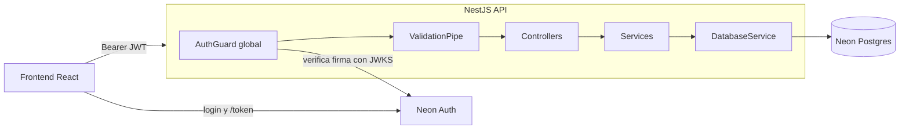
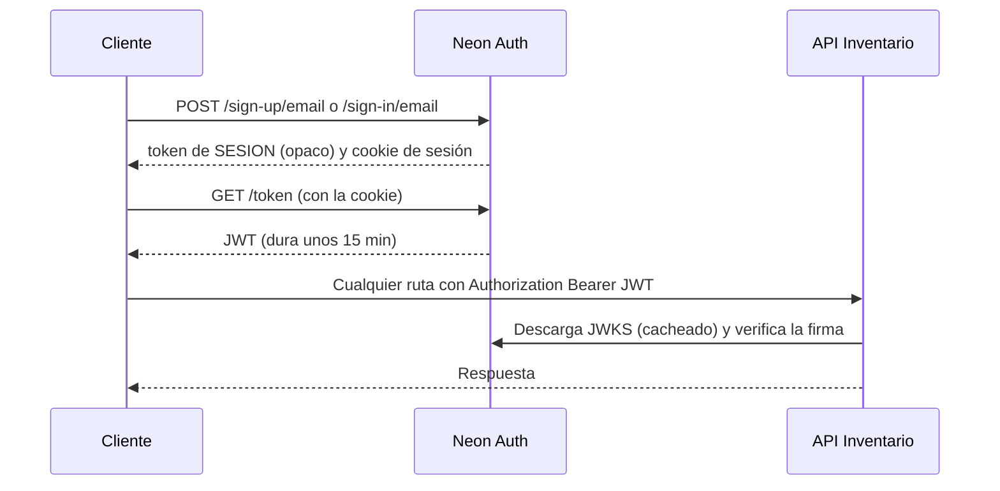
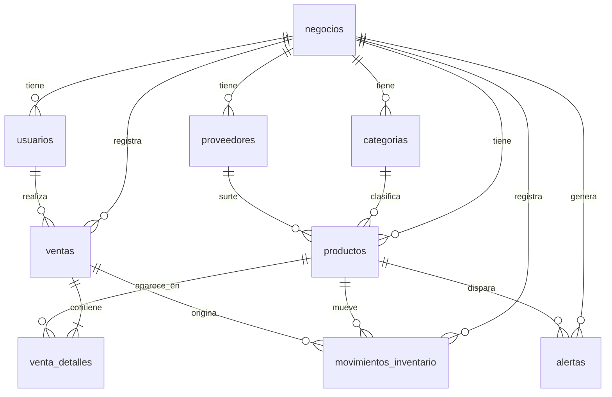
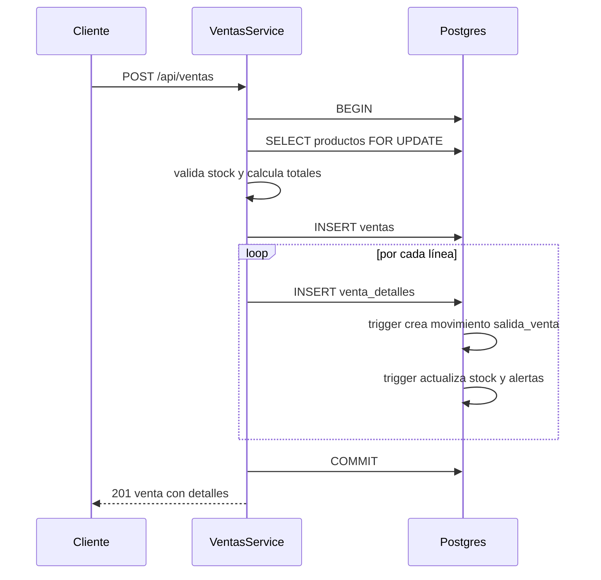

# Backend — Plataforma de inventario y ventas para pequeñas tiendas

> **Versión de la API:** 0.2.0 · **Prefijo de rutas:** `/api` · **Puerto por defecto:** `3000`

API REST construida con **NestJS** sobre **PostgreSQL (Neon)** y autenticación delegada a **Neon Auth** (Better Auth administrado). Permite a una tienda registrar su catálogo, controlar inventario en tiempo real, registrar ventas, recibir alertas de stock bajo y consultar reportes básicos.

---

## Índice

1. [Visión general](#1-visión-general)
2. [Stack tecnológico](#2-stack-tecnológico)
3. [Estructura del monorepo y del backend](#3-estructura-del-monorepo-y-del-backend)
4. [Arquitectura](#4-arquitectura)
5. [Autenticación y multi-tenencia](#5-autenticación-y-multi-tenencia)
6. [Base de datos](#6-base-de-datos)
7. [Reglas de negocio y flujos](#7-reglas-de-negocio-y-flujos)
8. [Referencia de endpoints](#8-referencia-de-endpoints)
9. [Manejo de errores](#9-manejo-de-errores)
10. [Metodología y convenciones de código](#10-metodología-y-convenciones-de-código)
11. [Configuración y ejecución](#11-configuración-y-ejecución)
12. [Pruebas y documentación de la API](#12-pruebas-y-documentación-de-la-api)
13. [Decisiones de diseño](#13-decisiones-de-diseño)
14. [Limitaciones conocidas y pendientes](#14-limitaciones-conocidas-y-pendientes)
15. [Cómo agregar un módulo nuevo](#15-cómo-agregar-un-módulo-nuevo)
16. [Glosario](#16-glosario)

---

## 1. Visión general

**Qué resuelve:** una pequeña tienda se registra, da de alta su catálogo con cantidades y precios, registra entradas y salidas de mercancía, vende, y el sistema:

- actualiza el inventario automáticamente tras cada movimiento o venta,
- genera una **alerta** cuando un producto llega a su stock mínimo,
- muestra **reportes** de ventas por periodo, productos más vendidos, utilidad y valor del inventario.

**Principios del diseño:**

| Principio | Cómo se aplica |
|---|---|
| **Multi-tenant** | Cada tienda es un `negocio`. Todas las tablas de negocio llevan `negocio_id` y **toda consulta lo filtra**. Una tienda nunca ve datos de otra. |
| **El stock se mueve solo con movimientos** | `productos.stock_actual` nunca se edita directamente; lo actualizan triggers de la base a partir del kardex. |
| **Historial inmutable** | Los productos se *desactivan* y las ventas se *anulan*; nada con historial se borra. |
| **Integridad en la base de datos** | Restricciones, triggers y transacciones protegen los datos aunque la capa de aplicación falle. |
| **Identidad delegada** | Contraseñas, sesiones y correos viven en Neon Auth; la API solo verifica el JWT. |

---

## 2. Stack tecnológico

| Capa | Tecnología | Para qué |
|---|---|---|
| Framework | **NestJS** (plantilla de Nest CLI, módulos **ESM**) | Estructura modular, inyección de dependencias, guards, pipes, filtros |
| Lenguaje | **TypeScript** | Tipado |
| Base de datos | **PostgreSQL en Neon** | Datos, triggers, vistas |
| Driver | **`pg`** (node-postgres) | Pool de conexiones y consultas SQL parametrizadas |
| Autenticación | **Neon Auth** (Better Auth administrado) | Registro, login y emisión de JWT |
| Verificación JWT | **`jose`** | Verifica firma contra el JWKS de Neon Auth |
| Validación | **`class-validator`** + **`class-transformer`** | DTOs y validación de entrada |
| Configuración | **`@nestjs/config`** | Lectura de variables de entorno |
| Pruebas (plantilla) | **Vitest** | Incluido por la plantilla; aún sin tests propios |
| Documentación API | **OpenAPI 3.0.3** (importable en **Apidog**) | Referencia de endpoints |

> Las versiones exactas están en `backend/package.json`.

---

## 3. Estructura del monorepo y del backend

```
inventario-pyme/
├─ .env                     ← variables de entorno (NO se sube a git)
├─ .gitignore
├─ package.json             ← workspaces: ["backend", "frontend"]
├─ db/
│  └─ schema.sql            ← tablas, tipos, triggers y vistas
├─ backend/                 ← esta API
└─ frontend/                ← React (pendiente)
```

```
backend/src/
├─ main.ts                  ← arranque: prefijo /api, pipes, filtros, CORS
├─ app.module.ts            ← módulo raíz: registra todos los módulos
├─ debug.controller.ts      ← rutas de depuración (temporales salvo /health)
├─ common/
│  ├─ dto.ts                ← toBool, DateRangeDto, resolveRange, round2
│  └─ pg-exception.filter.ts← traduce errores de Postgres a HTTP
├─ database/
│  ├─ database.module.ts    ← módulo GLOBAL
│  └─ database.service.ts   ← pool pg, query, queryOne, tx
├─ auth/
│  ├─ auth.guard.ts         ← guard GLOBAL: verifica JWT + carga el perfil
│  ├─ auth.decorators.ts    ← @Public, @AllowNoProfile, @Auth, @Tenant
│  ├─ auth.types.ts         ← AuthInfo, TenantCtx
│  └─ auth.module.ts        ← registra el guard como APP_GUARD
├─ negocio/                 ← /me y /onboarding
├─ catalogo/                ← categorías y proveedores
├─ productos/               ← catálogo de productos
├─ inventario/              ← movimientos (kardex)
├─ ventas/                  ← ventas, detalle y anulación
├─ alertas/                 ← bandeja de alertas de stock bajo
└─ reportes/                ← reportes de ventas e inventario
```

Cada módulo de negocio sigue el mismo patrón: `*.dto.ts` (entrada validada) → `*.controller.ts` (rutas) → `*.service.ts` (lógica y SQL) → `*.module.ts`.

---

## 4. Arquitectura

### 4.1 Vista general



### 4.2 Ciclo de vida de una petición

1. **CORS**: solo se aceptan los orígenes de `FRONTEND_URL`, con los métodos `GET, POST, PATCH, DELETE` y las cabeceras `Content-Type` y `Authorization`.
2. **`AuthGuard` (global)**:
   - Si la ruta es `@Public()`, pasa sin más.
   - Si no, exige `Authorization: Bearer <jwt>`, verifica firma, expiración e *issuer*, y extrae el `sub` (id del usuario en Neon Auth).
   - Busca el perfil en `usuarios` para obtener `negocio_id`, `usuario_id` y `rol`.
   - Si no hay perfil y la ruta no es `@AllowNoProfile()`, responde **403 `ONBOARDING_REQUIRED`**.
3. **`ValidationPipe` (global)**: valida y transforma `body`, `query` y `params` según los DTOs. Opciones: `whitelist`, `forbidNonWhitelisted` y `transform`.
4. **Controller**: recibe los datos ya validados y el contexto (`@Tenant()`, `@Auth()`).
5. **Service**: reglas de negocio y SQL. Toda consulta incluye `negocio_id`.
6. **`DatabaseService`**: pool de conexiones; `tx()` para transacciones.
7. **Postgres**: restricciones y triggers garantizan la integridad.
8. **`PgExceptionFilter` (global)**: convierte errores de Postgres (`23505`, `23514`, `23503`) en respuestas HTTP legibles.

### 4.3 Módulos y responsabilidades

| Módulo | Responsabilidad |
|---|---|
| `DatabaseModule` (global) | Provee el pool y la API `query`, `queryOne`, `tx` |
| `AuthModule` | Registra el `AuthGuard` global |
| `NegocioModule` | Perfil del usuario y alta del negocio |
| `CatalogoModule` | Categorías y proveedores |
| `ProductosModule` | CRUD de productos (baja lógica) |
| `InventarioModule` | Movimientos manuales y kardex |
| `VentasModule` | Registro, consulta y anulación de ventas |
| `AlertasModule` | Lectura y cierre de alertas |
| `ReportesModule` | Consultas agregadas |

---

## 5. Autenticación y multi-tenencia

### 5.1 Flujo para obtener un token



> ⚠️ El `token` que devuelven *sign-up* y *sign-in* es un **token de sesión opaco**, **no** un JWT. Para llamar a esta API hay que pedir el JWT con `GET /token` (en el frontend: `authClient.token()`).

### 5.2 Verificación del JWT (`auth.guard.ts`)

- Las claves públicas se leen del **JWKS**: `NEON_AUTH_BASE_URL` + `NEON_AUTH_JWKS_URL` (o `/.well-known/jwks.json` por defecto). Si `NEON_AUTH_JWKS_URL` es una URL completa, se usa tal cual.
- Se acepta como *issuer* el **origin** de `NEON_AUTH_BASE_URL` y también la URL completa.
- El `sub` debe ser un **UUID** (es el `id` de `neon_auth."user"`); si no, 401.

### 5.3 Decoradores

| Decorador | Efecto |
|---|---|
| `@Public()` | Ruta sin autenticación (p. ej. `/health`) |
| `@AllowNoProfile()` | Exige token válido pero **no** exige negocio (para `/me`, `/onboarding`) |
| `@Auth()` | Inyecta `{ authUserId, email, name }` del token |
| `@Tenant()` | Inyecta `{ usuarioId, negocioId, rol }` del perfil |

### 5.4 Multi-tenencia

```
JWT (sub) ──► usuarios.auth_user_id ──► negocio_id ──► filtro en TODAS las consultas
```

- Cada servicio recibe `TenantCtx` y usa `t.negocioId` en cada `WHERE`.
- Al referenciar entidades por id (categoría, proveedor, producto) se verifica que **pertenezcan al mismo negocio** antes de usarlas. Un id de otra tienda responde 400 o 404, nunca filtra datos.

### 5.5 Nombre y correo del usuario

No se duplican: el `nombre` y el `email` viven en Neon Auth. Cuando se necesita mostrar al vendedor se hace un `LEFT JOIN` a `neon_auth."user"` por `usuarios.auth_user_id`.

### 5.6 Roles

`usuarios.rol` admite `propietario` y `empleado`. **Hoy ningún endpoint distingue entre ambos** (ver [pendientes](#14-limitaciones-conocidas-y-pendientes)).

---

## 6. Base de datos

El esquema completo está en `db/schema.sql`. Se aplicó manualmente en el **SQL Editor de Neon** (no se usa aún una herramienta de migraciones).

### 6.1 Modelo entidad-relación



### 6.2 Tablas

| Tabla | Propósito | Notas clave |
|---|---|---|
| `negocios` | La tienda (tenant) | `moneda` (default `MXN`), `zona_horaria` (default `America/Monterrey`) |
| `usuarios` | Perfil de la app | `auth_user_id` **UUID único**, con llave foránea a `neon_auth."user"(id)`; `rol`; `activo` |
| `categorias` | Clasificación | `UNIQUE (negocio_id, nombre)` |
| `proveedores` | Proveedores | `activo` (baja lógica) |
| `productos` | Catálogo | `UNIQUE (negocio_id, sku)`; `stock_actual`, `stock_minimo`; `activo`; **`CHECK (stock_actual >= 0)`** |
| `ventas` | Encabezado de venta | `estado` (`completada` / `anulada`), `metodo_pago`, `subtotal`, `descuento`, `total` |
| `venta_detalles` | Líneas de venta | Guarda `precio_unitario` y `costo_unitario` **al momento de vender**; `subtotal` es columna generada |
| `movimientos_inventario` | **Kardex** | `cantidad` siempre positiva; el `tipo` define si suma o resta |
| `alertas` | Avisos de stock bajo | `leida` (false = pendiente); índice único parcial: **una sola pendiente por producto** |

**Tipos enumerados:**

| Tipo | Valores |
|---|---|
| `rol_usuario` | `propietario`, `empleado` |
| `estado_venta` | `completada`, `anulada` |
| `metodo_pago` | `efectivo`, `tarjeta`, `transferencia`, `otro` |
| `tipo_movimiento` | `entrada_compra`, `entrada_ajuste`, `entrada_anulacion`, `salida_venta`, `salida_ajuste`, `salida_devolucion` |

**Tipos numéricos:** dinero `NUMERIC(12,2)`; cantidades `NUMERIC(12,3)` (admiten decimales, p. ej. 0.5 kg).

### 6.3 Triggers (automatización del inventario)

| Trigger | Se dispara | Qué hace |
|---|---|---|
| `trg_salida_por_venta` → `fn_salida_por_venta()` | `AFTER INSERT` en `venta_detalles` | Inserta el movimiento `salida_venta` de esa línea |
| `trg_aplicar_movimiento` → `fn_aplicar_movimiento()` | `AFTER INSERT` en `movimientos_inventario` | Suma o resta a `stock_actual` (entradas suman, salidas restan); si una **salida** deja el stock `<= stock_minimo`, crea la alerta; si una **entrada** lo deja `> stock_minimo`, cierra las alertas pendientes |

Si el stock fuera a quedar negativo, el `CHECK` de `productos` aborta toda la transacción.

### 6.4 Vistas

El esquema define `v_ventas_diarias`, `v_desempeno_productos`, `v_stock_bajo` y `v_valor_inventario`. **La API no las usa**: los reportes consultan las tablas directamente porque necesitan filtros por fecha y zona horaria del negocio. Quedan disponibles para consultas manuales.

### 6.5 Índices destacados

- `productos (negocio_id, nombre)` para búsquedas.
- Índice parcial de productos con stock bajo.
- `ventas (negocio_id, fecha)` y `movimientos_inventario (negocio_id, fecha)` para reportes.
- `uq_alerta_pendiente`: único parcial `(producto_id) WHERE NOT leida`.

---

## 7. Reglas de negocio y flujos

### 7.1 Onboarding (alta de la tienda)

1. El usuario se registra en Neon Auth (aún no tiene negocio).
2. `GET /me` devuelve `perfil: null` → el frontend muestra el alta.
3. `POST /onboarding` crea, **en una sola transacción**, el `negocio` y el perfil (`usuarios`) con rol `propietario`. Repetirlo da 409.

### 7.2 Productos

- **El stock no se edita**: `PATCH` no acepta `stock_actual`.
- **`stock_inicial`** al crear un producto se registra como un movimiento `entrada_ajuste` con motivo "Stock inicial", para que el kardex cuadre desde el día uno.
- **SKU** único por negocio.
- **Baja lógica**: `DELETE` marca `activo = false` (ver [8.5](#85-productos)).
- Al cambiar `stock_minimo` o `activo` por `PATCH`, el servicio **recalcula la alerta** (los triggers solo reaccionan a movimientos).

### 7.3 Movimientos de inventario

- Manuales permitidos: `entrada_compra`, `entrada_ajuste`, `salida_ajuste`, `salida_devolucion`.
- `salida_venta` y `entrada_anulacion` **no** se pueden crear a mano: las generan las ventas.
- El producto debe estar **activo**; se bloquea con `FOR UPDATE` durante la transacción.
- Las compras guardan `costo_unitario` en el movimiento, pero **no modifican** `productos.precio_costo`.

### 7.4 Ventas



Reglas:

1. Se crea **primero `ventas` y después `venta_detalles`**, todo en una transacción. Si algo falla, no queda nada a medias.
2. Los productos deben existir, ser del negocio y estar activos (si no, 400).
3. **Stock suficiente**: se suman las líneas repetidas del mismo producto; si no alcanza, **409** con el stock disponible.
4. `precio_unitario` es opcional: si se omite se usa el `precio_venta` vigente. Se guarda en la línea junto con el `costo_unitario` del producto, de modo que **cambios de precio posteriores no alteran el historial**.
5. `descuento` es un **monto** (no porcentaje) y no puede superar el subtotal.
6. `total = subtotal − descuento`, redondeado a 2 decimales.

### 7.5 Anulación de ventas

1. Bloquea la venta (`FOR UPDATE`); si ya estaba anulada → 409.
2. Cambia `estado` a `anulada`.
3. Inserta un movimiento `entrada_anulacion` por cada línea → los triggers devuelven el stock.
4. La venta anulada **no cuenta** en los reportes.

### 7.6 Ciclo de vida de las alertas

| Evento | Resultado |
|---|---|
| Una salida deja el stock `<= stock_minimo` | Se crea una alerta (si no hay ya una pendiente del producto) |
| Una entrada deja el stock `> stock_minimo` | Se cierran las alertas pendientes del producto |
| `PATCH /productos/:id` con `stock_minimo` o `activo` | Se reevalúa: se abre o se cierra |
| `DELETE /productos/:id` | Se cierran las pendientes |
| `PATCH /alertas/:id/leer` o `/leer-todas` | Se marcan como leídas manualmente |

Una alerta marcada como leída **no impide** que se genere otra nueva en la siguiente salida, porque la unicidad solo aplica a las pendientes.

### 7.7 Reportes

- Solo cuentan ventas con `estado = 'completada'`.
- Los periodos (`dia`, `semana`, `mes`) se calculan en la **zona horaria del negocio**; la semana empieza en lunes.
- **Utilidad** = Σ (precio − costo) × cantidad de cada línea − descuentos. Usa el costo guardado en cada línea.
- Rango de fechas: `desde` inclusivo, `hasta` **exclusivo**, en ISO 8601. Por defecto, los últimos 30 días.

---

## 8. Referencia de endpoints

Todas las rutas llevan el prefijo `/api`. **Todas exigen** `Authorization: Bearer <JWT>` salvo `/health`. Las rutas de negocio exigen además haber hecho el onboarding.

### 8.1 Resumen

| Grupo | Método | Ruta | Descripción |
|---|---|---|---|
| Sistema | GET | `/health` | Estado de la API y la BD (público) |
| Sistema | GET | `/whoami` | Identidad del token (temporal) |
| Cuenta | GET | `/me` | Identidad, perfil y negocio |
| Cuenta | POST | `/onboarding` | Crear el negocio del usuario |
| Catálogo | GET | `/categorias` | Listar categorías |
| Catálogo | POST | `/categorias` | Crear categoría |
| Catálogo | GET | `/proveedores` | Listar proveedores activos |
| Catálogo | POST | `/proveedores` | Crear proveedor |
| Productos | GET | `/productos` | Listar / buscar |
| Productos | POST | `/productos` | Crear |
| Productos | GET | `/productos/:id` | Obtener uno |
| Productos | PATCH | `/productos/:id` | Editar |
| Productos | DELETE | `/productos/:id` | Desactivar (baja lógica) |
| Inventario | POST | `/inventario/movimientos` | Registrar entrada o salida manual |
| Inventario | GET | `/inventario/movimientos` | Kardex |
| Ventas | POST | `/ventas` | Registrar una venta |
| Ventas | GET | `/ventas` | Historial |
| Ventas | GET | `/ventas/:id` | Detalle |
| Ventas | PATCH | `/ventas/:id/anular` | Anular |
| Alertas | GET | `/alertas` | Listar |
| Alertas | PATCH | `/alertas/leer-todas` | Marcar todas como leídas |
| Alertas | PATCH | `/alertas/:id/leer` | Marcar una como leída |
| Reportes | GET | `/reportes/resumen` | Totales del periodo e inventario |
| Reportes | GET | `/reportes/ventas` | Ventas por día, semana o mes |
| Reportes | GET | `/reportes/productos-top` | Más vendidos |
| Reportes | GET | `/reportes/inventario` | Estado y valor del inventario |

### 8.2 Sistema

**`GET /health`** (público) → `200`
```json
{ "ok": true, "db_time": "2026-10-14T20:30:00.000Z" }
```
Comprueba la conexión con Neon. Conviene conservarlo para *health checks* del hosting.

**`GET /whoami`** → `200`
```json
{ "authUserId": "uuid", "email": "ana@ejemplo.com", "name": "Ana" }
```
Ruta de depuración: eliminar antes de publicar.

### 8.3 Cuenta

**`GET /me`** → `200`
```json
{
  "auth":    { "authUserId": "uuid", "email": "ana@ejemplo.com", "name": "Ana" },
  "perfil":  { "usuario_id": 1, "rol": "propietario" },
  "negocio": { "id": 1, "nombre": "Abarrotes Ana", "moneda": "MXN", "zona_horaria": "America/Monterrey" }
}
```
Si el usuario aún no tiene negocio, `perfil` y `negocio` son `null`.

**`POST /onboarding`** → `201`

| Campo | Tipo | Reglas |
|---|---|---|
| `nombre_negocio` | string | **Requerido**, 2–150 caracteres |
| `moneda` | string | Opcional, 3 caracteres (se guarda en mayúsculas). Default `MXN` |
| `zona_horaria` | string | Opcional, hasta 50 caracteres. Default `America/Monterrey` |

Respuesta: `{ "negocio": { ... }, "perfil": { "usuario_id": 1, "rol": "propietario" } }`.
Errores: `400` datos inválidos · `409` el usuario ya tiene un negocio.

### 8.4 Catálogo

**`GET /categorias`** → `[ { "id": 1, "nombre": "Bebidas" } ]`

**`POST /categorias`** → `201` · cuerpo `{ "nombre": "Bebidas" }` (1–100). `409` si ya existe en el negocio.

**`GET /proveedores`** → proveedores **activos**: `[ { "id", "nombre", "telefono", "email", "activo" } ]`

**`POST /proveedores`** → `201` · cuerpo:

| Campo | Reglas |
|---|---|
| `nombre` | **Requerido**, 1–150 |
| `telefono` | Opcional, hasta 30 |
| `email` | Opcional, formato de correo |

### 8.5 Productos

**`GET /productos`** → lista ordenada por nombre. Filtros (todos opcionales):

| Query | Efecto |
|---|---|
| `q` | Busca en nombre o SKU, sin distinguir mayúsculas |
| `activo` | `true` solo activos · `false` solo desactivados · sin enviar = todos |
| `stock_bajo` | `true` solo productos con `stock_actual <= stock_minimo` |

Cada elemento: `id, sku, nombre, descripcion, precio_costo, precio_venta, stock_actual, stock_minimo, activo, categoria_id, categoria, proveedor_id, stock_bajo`.

**`POST /productos`** → `201` (devuelve el producto con `negocio_id`, `creado_en`, `actualizado_en`)

| Campo | Reglas |
|---|---|
| `sku` | **Requerido**, 1–60, único por negocio |
| `nombre` | **Requerido**, 1–200 |
| `precio_venta` | **Requerido**, ≥ 0, máx. 2 decimales |
| `descripcion` | Opcional |
| `categoria_id`, `proveedor_id` | Opcionales; deben ser del negocio |
| `precio_costo` | Opcional, ≥ 0 (default 0) |
| `stock_minimo` | Opcional, ≥ 0, máx. 3 decimales (default 0) |
| `stock_inicial` | Opcional, ≥ 0; se registra como movimiento `entrada_ajuste` |

Errores: `400` validación / categoría o proveedor inválido · `409` SKU repetido. Enviar `stock_actual` da `400` (campo no permitido).

**`GET /productos/:id`** → producto, o `404`.

**`PATCH /productos/:id`** → actualiza solo los campos enviados (al menos uno; si no, `400 "Nada que actualizar"`).
Campos permitidos: `sku, nombre, descripcion, categoria_id, proveedor_id, precio_costo, precio_venta, stock_minimo, activo`. **No** acepta `stock_actual`.
Errores: `400`, `404`, `409` (SKU repetido).

**`DELETE /productos/:id`** → `200 { "id": 1, "activo": false }` — **baja lógica**:

- No borra el registro: marca `activo = false` y conserva todo su historial.
- Deja de poder venderse (`POST /ventas` → 400) y de recibir movimientos (`POST /inventario/movimientos` → 404).
- Cierra sus alertas pendientes.
- Sigue apareciendo en `GET /productos` sin filtros y en `GET /productos/:id`.
- Es **idempotente**: repetirlo responde 200.
- Para **reactivarlo**: `PATCH /productos/:id` con `{ "activo": true }` (si su stock sigue `<=` al mínimo, la alerta se reabre).
- Id inexistente o de otro negocio → `404`.

### 8.6 Inventario

**`POST /inventario/movimientos`** → `201`

| Campo | Reglas |
|---|---|
| `producto_id` | **Requerido**, activo y del negocio (si no, 404) |
| `tipo` | **Requerido**: `entrada_compra`, `entrada_ajuste`, `salida_ajuste`, `salida_devolucion` |
| `cantidad` | **Requerido**, ≥ 0.001, máx. 3 decimales; siempre positiva |
| `costo_unitario` | Opcional, ≥ 0 |
| `proveedor_id` | Opcional; debe ser del negocio |
| `motivo` | Opcional, hasta 500 |

Respuesta: estado del producto tras el movimiento
```json
{ "id": 1, "nombre": "Coca-Cola 600ml", "stock_actual": 30, "stock_minimo": 3, "stock_bajo": false }
```
Errores: `400` (tipo no permitido, proveedor inválido, o salida mayor al stock) · `404` producto inexistente o inactivo.

**`GET /inventario/movimientos`** → kardex, del más reciente al más antiguo.

| Query | Reglas |
|---|---|
| `producto_id` | Opcional |
| `limit` | 1–200 (default 50) |

Elemento: `id, fecha, tipo, cantidad, costo_unitario, motivo, venta_id, producto_id, producto, proveedor`.

### 8.7 Ventas

**`POST /ventas`** → `201`

```json
{
  "items": [
    { "producto_id": 1, "cantidad": 2 },
    { "producto_id": 2, "cantidad": 1, "precio_unitario": 15 }
  ],
  "metodo_pago": "tarjeta",
  "descuento": 0,
  "notas": "opcional"
}
```

| Campo | Reglas |
|---|---|
| `items` | **Requerido**, al menos 1 |
| `items[].producto_id` | **Requerido** |
| `items[].cantidad` | **Requerido**, ≥ 0.001 |
| `items[].precio_unitario` | Opcional; si se omite se usa el precio actual |
| `metodo_pago` | Opcional: `efectivo` (default), `tarjeta`, `transferencia`, `otro` |
| `descuento` | Opcional, monto ≥ 0; no puede superar el subtotal |
| `notas` | Opcional, hasta 500 |

Respuesta: la venta con sus `detalles` y el `vendedor`.
Errores: `400` (validación, producto inexistente o inactivo, descuento mayor al subtotal) · `409` stock insuficiente.

**`GET /ventas`** → historial (incluye anuladas, campo `estado`), sin líneas.

| Query | Reglas |
|---|---|
| `desde`, `hasta` | ISO 8601; default últimos 30 días; `hasta` exclusivo |
| `limit` | 1–200 (default 50) |
| `offset` | ≥ 0 (default 0) |

**`GET /ventas/:id`** → venta con `detalles` (`id, producto_id, producto, sku, cantidad, precio_unitario, subtotal`) y `vendedor`. `404` si no existe.

**`PATCH /ventas/:id/anular`** → `200` con la venta (`estado: "anulada"`). `404` si no existe · `409` si ya estaba anulada.

### 8.8 Alertas

**`GET /alertas`** → más recientes primero (máx. 100).

| Query | Efecto |
|---|---|
| `pendientes` | `true` (default) solo pendientes · `false` todas |

Elemento: `id, mensaje, stock_al_generar, leida, creada_en, producto_id, producto, stock_actual, stock_minimo`.

**`PATCH /alertas/leer-todas`** → `{ "marcadas": 3 }`

**`PATCH /alertas/:id/leer`** → `{ "id": 1, "leida": true }` · `404` si no existe.

### 8.9 Reportes

Todos aceptan `desde` / `hasta` salvo `/inventario`.

**`GET /reportes/resumen`** → tarjetas del panel
```json
{
  "periodo": { "desde": "...", "hasta": "..." },
  "num_ventas": 2, "total_vendido": 100, "ticket_promedio": 50,
  "descuentos": 0, "utilidad": 36,
  "inventario": { "productos_activos": 2, "productos_stock_bajo": 1, "valor_costo": 286, "valor_venta": 430 }
}
```

**`GET /reportes/ventas?agrupar=dia|semana|mes`** → `[ { "periodo": "2026-10-12", "num_ventas": 1, "total_vendido": 52 } ]`
`periodo` es el primer día del grupo, en la zona horaria del negocio.

**`GET /reportes/productos-top?limit=10`** → ordenado por unidades: `[ { "producto_id", "nombre", "unidades", "ingresos", "utilidad" } ]` (`limit` 1–50).

**`GET /reportes/inventario`** → foto actual de productos activos: `productos_activos`, `productos_stock_bajo`, `valor_costo` (Σ stock × costo), `valor_venta` (Σ stock × precio).

---

## 9. Manejo de errores

### 9.1 Códigos de respuesta

| Código | Cuándo | Ejemplo de cuerpo |
|---|---|---|
| `400` | Validación o regla de negocio | `{"statusCode":400,"error":"Bad Request","message":["precio_venta must not be less than 0"]}` |
| `401` | Falta el token, es inválido o expiró | `{"message":"Token inválido o expirado","error":"Unauthorized","statusCode":401}` |
| `403` | Token válido pero sin negocio | `{"code":"ONBOARDING_REQUIRED","message":"Primero crea tu negocio"}` |
| `404` | No existe (o es de otro negocio) | `{"message":"Producto no encontrado","error":"Not Found","statusCode":404}` |
| `409` | Conflicto (SKU repetido, stock insuficiente, ya anulada, ya tiene negocio) | `{"message":"Stock insuficiente de \"Sabritas\" (disponible: 4)",...}` |

`message` es un **texto** o, cuando falla la validación del DTO, una **lista de textos**. El frontend debe contemplar ambos.

### 9.2 Errores de Postgres traducidos (`PgExceptionFilter`)

| Código PG | Significado | Respuesta |
|---|---|---|
| `23505` | Violación de unicidad | `409` "Ya existe un registro con esos datos (¿SKU repetido?)" |
| `23514` | Violación de `CHECK` (stock negativo, etc.) | `400` "Operación inválida: stock insuficiente o valor fuera de rango" |
| `23503` | Llave foránea inválida | `400` "Referencia inválida: algún id no existe" |

Cualquier otro error se deja pasar (el filtro base de Nest lo convierte en 500).

### 9.3 Aislamiento entre negocios

Acceder a un recurso de otra tienda devuelve **404** (o 400 si se referencia desde un cuerpo), igual que si no existiera. Nunca se revela su existencia.

---

## 10. Metodología y convenciones de código

### 10.1 Cómo se construyó

El backend se desarrolló **por pasos incrementales**, validando cada uno antes de avanzar:

1. Proyecto en Neon con Auth habilitado y variables de entorno.
2. Esqueleto del monorepo y proyecto NestJS.
3. Esquema de base de datos y prueba de triggers.
4. Conexión a la BD y verificación del JWT.
5. Onboarding.
6. Catálogo y productos.
7. Inventario y ventas.
8. Alertas y reportes.

Cada módulo se verificó con peticiones reales (curl / Apidog), incluyendo los **casos de error** (SKU repetido, stock insuficiente, tokens inválidos, aislamiento entre negocios).

### 10.2 Convenciones

| Tema | Convención |
|---|---|
| **Módulos ESM** | Todo import relativo lleva extensión `.js` (aunque el archivo sea `.ts`). Los imports de tipos usan `import type`. |
| **Acceso a datos** | SQL directo, siempre **parametrizado** (`$1, $2…`). Nunca se concatenan valores del cliente. |
| **Nombres de columnas dinámicas** | Solo desde **listas blancas** (p. ej. `UPDATABLE` en productos). |
| **Transacciones** | Cualquier operación de varios pasos usa `db.tx()`. |
| **Bloqueos** | `SELECT … FOR UPDATE` sobre productos (ventas y movimientos) y sobre la venta (anulación). |
| **Multi-tenencia** | Todo `WHERE` incluye `negocio_id`; las referencias cruzadas se validan con el mismo criterio. |
| **DTOs** | Un DTO por entrada. `whitelist` + `forbidNonWhitelisted`: un campo no declarado da 400. |
| **Tipos de PG → JS** | `BIGINT` y `NUMERIC` se devuelven como `number`; `DATE` como texto `YYYY-MM-DD`. |
| **Dinero** | Se redondea a 2 decimales con `round2`. |
| **Idioma** | Mensajes de error al usuario en español; código y nombres de campos en español/inglés técnico según el dominio. |
| **Soft delete** | Productos y proveedores usan `activo`; ventas usan `estado`. |

### 10.3 Patrón de un módulo

```
dto  →  controller  →  service  →  DatabaseService  →  Postgres
(valida)  (rutas)     (reglas+SQL)   (pool, tx)         (constraints, triggers)
```

---

## 11. Configuración y ejecución

### 11.1 Variables de entorno (`.env` en la raíz)

| Variable | Obligatoria | Descripción |
|---|---|---|
| `DATABASE_URL` | Sí | Cadena de conexión a Neon (la **pooled**, para la app) |
| `DATABASE_URL_UNPOOLED` | No | Conexión directa, útil para migraciones |
| `NEON_AUTH_BASE_URL` | Sí | URL de Neon Auth, p. ej. `https://ep-xxx.neon.tech/neondb/auth`, sin barra final |
| `NEON_AUTH_JWKS_URL` | No | Ruta (`/.well-known/jwks.json`) o URL completa del JWKS. Si falta, se usa la ruta por defecto |
| `NEON_BRANCH` | No | Rama de Neon (informativa) |
| `PORT` | No | Puerto de la API (default `3000`) |
| `FRONTEND_URL` | No | Origen(es) permitidos por CORS, separados por coma (default `http://localhost:5173`) |

El backend busca el archivo en este orden: `../.env.local`, `../.env`, `.env` (relativo a `backend/`).

> ⚠️ `--watch` **no** vuelve a leer el `.env`: tras cambiarlo hay que reiniciar el servidor. **Nunca** subas el `.env` ni pegues credenciales en chats o documentación.

### 11.2 Arranque

```bash
# desde la raíz del monorepo
npm install
npm run dev:backend        # http://localhost:3000/api
```

### 11.3 Base de datos

El esquema (`db/schema.sql`) se aplica **una sola vez** en el SQL Editor de Neon, con **Neon Auth ya habilitado** (la llave foránea apunta a `neon_auth."user"`). Los `CREATE TYPE` no son repetibles. Para cambios posteriores, escribe scripts SQL incrementales (`ALTER TABLE …`).

### 11.4 Despliegue (recomendaciones)

- Variables de entorno en el proveedor de hosting, no en el repositorio.
- Usar `/api/health` como *health check*.
- `FRONTEND_URL` con el dominio real del frontend.
- Agregar el dominio del frontend en Neon Auth → Configuration → Domains.
- Eliminar las rutas de depuración (`/whoami` y cualquier otra no oficial).

---

## 12. Pruebas y documentación de la API

### 12.1 Apidog

La API está documentada en **OpenAPI 3.0.3** y se importa en Apidog con dos archivos:

| Archivo | Contenido | URL base del entorno |
|---|---|---|
| `openapi-api.json` | Los 26 endpoints de esta API | `http://localhost:3000/api` |
| `openapi-neon-auth.json` | Servicio externo: sign-up, sign-in, `/token`, JWKS | Tu `NEON_AUTH_BASE_URL` |

Recomendaciones:

- Un **módulo** por archivo, y la URL base de cada uno en el **entorno** (usa un entorno real como "desarrollo", no los *Mock*).
- Guarda el JWT en una variable de entorno `token` (extraída de la respuesta de `GET /token`) y úsala como autenticación Bearer de la API. El JWT dura ~15 min.
- Antes de compartir la documentación, reemplaza correos, contraseñas y tokens reales de los ejemplos.

### 12.2 Verificación de rutas

Al arrancar, Nest lista cada ruta registrada (`Mapped {/api/…, GET} route`). Si una no aparece, el controlador no la declara. Deben listarse **26 operaciones**, más cualquier ruta de depuración que hayas agregado.

### 12.3 Pruebas automatizadas

La plantilla incluye **Vitest**, pero el proyecto **aún no tiene tests propios**. Con ESM + decoradores de Nest, la inyección de dependencias en tests requiere compilar con un transformador que soporte `emitDecoratorMetadata` (por ejemplo SWC). Revisa que la `vitest.config.ts` de la plantilla lo incluya antes de escribir tests de servicios.

---

## 13. Decisiones de diseño

| Decisión | Alternativa descartada | Motivo |
|---|---|---|
| **SQL directo con `pg`** | ORM (Prisma/TypeORM) | Los triggers, bloqueos `FOR UPDATE`, `date_trunc` con zona horaria y consultas agregadas son más claros y controlables en SQL |
| **`stock_actual` guardado en `productos`** + kardex | Calcular el stock sumando movimientos | Lectura rápida en el panel; el kardex permite reconstruirlo y auditarlo |
| **Triggers para el stock** | Actualizarlo desde el código | La regla vive donde están los datos: ninguna ruta (ni un script futuro) puede saltársela |
| **`CHECK (stock_actual >= 0)`** | Solo validar en la API | Red de seguridad contra condiciones de carrera |
| **Precio y costo en cada línea de venta** | Leerlos del producto al reportar | Los reportes históricos no cambian si cambian los precios |
| **Baja lógica** (`activo`, `estado`) | `DELETE` real | Hay historial que referencia esos registros |
| **Verificar el JWT localmente con JWKS** | Preguntar a Neon Auth en cada petición | Más rápido y sin dependencia de red por petición (las claves se cachean) |
| **Perfil propio (`usuarios`) sin `nombre`/`email`** | Duplicar datos de Neon Auth | Una sola fuente de verdad; el nombre se obtiene con `LEFT JOIN` |
| **`auth_user_id` UUID con llave foránea a `neon_auth."user"`** | `TEXT` sin llave | Integridad referencial; el id de Neon Auth es UUID |
| **Cantidades `NUMERIC(12,3)`** | Enteros | Permite productos por peso o volumen |
| **Numéricos como `number` en JS** | Cadenas o librería decimal | Suficiente para una tienda pequeña; se redondea con `round2` |
| **Anular en lugar de borrar ventas** | `DELETE` | Trazabilidad y reportes consistentes |

---

## 14. Limitaciones conocidas y pendientes

**Funcionales**

- **Roles sin aplicar**: `propietario` y `empleado` existen, pero ningún endpoint los distingue.
- **Un solo usuario por negocio** en la práctica: no hay flujo para invitar empleados (Neon Auth incluye tablas de organización y miembros que podrían aprovecharse).
- **Categorías y proveedores**: solo se pueden listar y crear (sin editar ni desactivar).
- **Las compras no actualizan `precio_costo`**: el costo de cada compra queda en el movimiento, pero el producto conserva el suyo.
- **Descuentos**: solo por monto, no por porcentaje.
- **Sin código de barras**: previsto a futuro (`ALTER TABLE productos ADD COLUMN codigo_barras` + índice único parcial por negocio).
- **Sin paginación** en `GET /productos`; las alertas se limitan a 100.

**Técnicas**

- `zona_horaria` y `moneda` **no se validan** al crear el negocio: una zona inválida rompería los reportes.
- Los bloqueos `FOR UPDATE` de una venta no se ordenan por id: dos ventas simultáneas con productos en común podrían, en teoría, bloquearse mutuamente. Mejora sugerida: `ORDER BY id` en esa consulta.
- Dinero como `number` de JavaScript; si el negocio crece, considerar centavos enteros o una librería decimal.
- **Sin migraciones versionadas** (el esquema se aplicó a mano).
- **Sin pruebas automatizadas**, ni *rate limiting*, ni cabeceras de seguridad adicionales (p. ej. `helmet`), ni registro estructurado.
- Las vistas SQL del esquema no se usan desde la API.
- El JWT dura ~15 min: el frontend debe renovarlo.

**Limpieza antes de publicar**

- Eliminar `GET /whoami` y cualquier ruta de depuración extra; conservar `/health`.

---

## 15. Cómo agregar un módulo nuevo

Lista de verificación (ejemplo: `clientes`):

1. **Esquema**: crea la tabla con `negocio_id` (llave foránea, `ON DELETE CASCADE`) y sus índices; aplica el SQL en Neon.
2. **DTOs** (`clientes.dto.ts`): un DTO por entrada, con `class-validator`. Si hay filtros en la URL, usa `@Type(() => Number)` o `toBool()`.
3. **Servicio** (`clientes.service.ts`):
   - Recibe `TenantCtx` y usa `t.negocioId` en **cada** consulta.
   - Valida con `assertOwned`-style que los ids referenciados sean del negocio.
   - Usa `db.tx()` si hay varios pasos.
   - Para actualizaciones parciales, usa una lista blanca de columnas.
4. **Controlador** (`clientes.controller.ts`): rutas delgadas con `@Tenant()`, `ParseIntPipe` en los `:id`.
5. **Módulo** (`clientes.module.ts`) y **regístralo** en `app.module.ts`.
6. **Imports** con extensión `.js` y `import type` para los tipos.
7. **Verifica** que cada ruta aparezca en el log al arrancar, y prueba los casos de error (datos inválidos, id inexistente, id de otro negocio, 401 y 403).
8. **Documenta** en el OpenAPI y reimporta en Apidog.

---

## 16. Glosario

| Término | Significado |
|---|---|
| **Tenant / negocio** | Una tienda; unidad de aislamiento de datos |
| **Kardex** | Historial de movimientos de inventario (`movimientos_inventario`) |
| **SKU** | Código interno que la tienda asigna a un producto; único por negocio |
| **Stock mínimo** | Umbral a partir del cual se genera la alerta de stock bajo |
| **Baja lógica** | Desactivar un registro (`activo = false`) en lugar de borrarlo |
| **JWT** | Token firmado que identifica al usuario; dura ~15 minutos |
| **JWKS** | Conjunto de claves públicas con las que se verifica la firma del JWT |
| **Token de sesión** | Cadena opaca de Neon Auth (cookie); **no** sirve como Bearer de esta API |
| **Onboarding** | Alta inicial del negocio de un usuario recién registrado |
| **DTO** | Clase que describe y valida los datos de entrada de una ruta |
| **Guard / Pipe / Filter** | Piezas de NestJS: autorización, validación/transformación y manejo de excepciones |
| **Pooled / unpooled** | Conexión a Neon a través del pooler (para la app) o directa (para migraciones) |